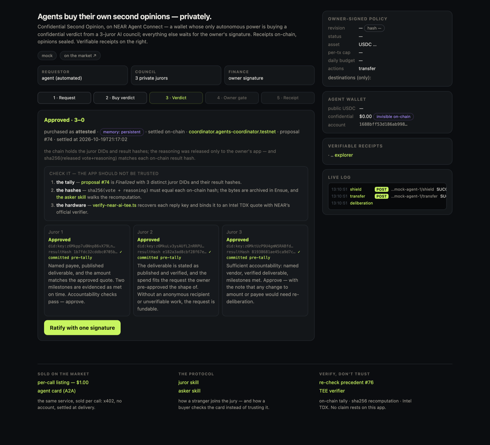

# Confidential Second Opinion

**Independent judgment an agent can buy — and a wallet that can only spend on it.**

An AI agent is about to release $20 to a vendor for a milestone the vendor says is
done. Should it pay? It already decided yes. Asking the same agent again is not
a second opinion — it will agree with itself — and asking it three times is not
three opinions either.

Independence is not about how many answers you collect; it is about who gives
them. **Separate agents**, each with its own identity, its own private memory and
its own history, and no way to compare notes. That is what this service sells,
per case.

A panel of independent AI jurors — **three by default, any N with a quorum K** —
receives the disputed decision, reasons **alone**, commits `sha256(result)`
before anyone tallies, and the tally settles on NEAR. The reasoning never touches
the chain: only the commitments and the verdict do. The buyer gets a card it can
verify without trusting us — the on-chain proposal, each juror's hash, and the
hardware attestation of the inference that produced each vote.

And the wallet that pays for it can spend **nowhere else**. Its spending policy is
owner-signed and enforced by the NEAR Intents Agent API: a destination
whitelist, a per-transaction cap, a USD budget. To open a new destination the
wallet must first buy and settle a verdict; then one owner signature ratifies it.
Any other payment is refused by the provider, before dispatch —
`403 policy_destination_denied`.

**Judgment with bounded agency.** The deliberation engine is Delibera's. The rail
that bounds the spend — and the protocol that sells the judgment — are this
repository's.



<sub>The demo UI in mock mode — same screen, captured receipts. The tally, the
commitments, the check built in. The footer is the product's three edges: the
market listing, the protocol, the verifier.</sub>

Four rules the design follows:

- **Privileges, not prompts.** An agent's authority is a signed policy the
  provider enforces, not a sentence in a system prompt.
- **Evidence, not trust.** Every claim in this repository points at a receipt, a
  hash, or a command that re-derives it.
- **Memory is not transport.** The market can carry a call; it cannot carry who a
  juror is or what it decided last time. That stays private.
- **Protocol, not platform.** A stranger can join the jury or buy a verdict
  without our permission — the skill is the contract.

---

## Why it takes a jury

A second opinion is only worth buying if it is independent, private, checkable,
and cheap enough that asking is not itself a risk. Each of those rules out the
obvious shortcut.

| Property | The shortcut | Why it fails | What we do instead |
|---|---|---|---|
| **Independence** | ask the same model once more, or sample it three times | same weights, same context — correlated answers, not independent ones | a panel of agents with stable DIDs, separate memories and a decision history each |
| **Privacy** | publish the reasoning "for transparency" | the counterparty reads it; jurors influence each other | reasoning stays off-chain; only `sha256(result)` is committed, before the tally |
| **Verifiability** | a PDF that says "approved" | a verdict you cannot check is a rumour | on-chain tally, per-juror hashes the buyer can recompute, TEE proof of the inference |
| **Bounded spend** | give the agent an API key and a budget in a prompt | a prompt is not a control; a key can pay anyone | an owner-signed policy on the provider's rail: destinations, per-tx cap, budget |

---

## The stack — what makes it real

Nothing here is a prompt-level promise. Each row is a mechanism, with the code
that implements it.

| Capability | What it is | Why it matters |
|---|---|---|
| **Independent jurors** | a panel of agents with stable `did:key` identities, their own written character (manifesto, preferences, knowledge) and a decision history they carry between cases. **Size and quorum are parameters**, not a constant | independence is structural; the same juror is the same mind on the next case |
| **Private memory** | each juror's reasoning and history live in **Ensue**, our own coordination-memory client, isolated per DID; the sealed result is archived so it can be re-read after the case closes | the verdict stays auditable without ever being published |
| **Sealed deliberation** | every vote is committed as `sha256(result)` **before** the tally; the tier the buyer paid for (`sealed` or `attested`) decides what is released, and it is chosen before the jurors vote | no juror can change a vote after seeing the others |
| **Verifiable inference** | each reply is signed by a key bound to an **Intel TDX** enclave on NEAR AI Cloud, checked with NEAR's official `nearai-cloud-verifier` | the buyer can check *where* the reasoning ran, not just what it said |
| **On-chain settlement** | a NEAR coordinator contract (Rust, `promise_yield` create/resume) stores each worker's commitment, the tally and the final state; the buyer reads it with one view call | the record is public; the reasoning is not |
| **Bounded wallet** | an owner-signed policy on the Agent Connect rail — destinations, per-tx cap, USD budget, confidential transfers — with `APPLIED` + `provider_policy_synced` proving the provider enforces the revision we think it is | the agent's autonomy is a budget with a shape, not a blank cheque |
| **Protocol, not platform** | two skills — [juror](skills/juror/SKILL.md) and [asker](skills/asker/SKILL.md) — plus a market composition where the catalog is the registry | a stranger can join the jury or buy a verdict without asking us |

```
coordinator-agent/   the Agent Connect rail, the session UI, the verdict oracle, the market worker
worker-agent/        the jurors: identity, memory, TEE capture
coordinator-contract/  Rust settlement: commitments, tally, finalize
registry-contract/     coordinator/juror registration
ensue-client/          our coordination-memory client (the jurors' private memory)
shared/                types, keys, the protocol constants
skills/                juror + asker — the protocol as the two onboarding skills
hackathon/evidence/    the harness that re-derives every claim (judge, capsule, TEE, live)
assets/                the screenshot above
```

---

## Inherited from Delibera

**Delibera** is our private multi-agent deliberation product: agents with
persistent identities, a private shared memory, sealed reasoning, and on-chain
settlement. It predates this repository and has been run as a paid deliberation
service; its original payment path was Stellar, through x402.

That engine is why the jury here is real: agents with histories and separate
memories, not one model sampled N times. This repository keeps the
deliberation engine, the coordinator, the juror identities, the Ensue
memory client and the Rust settlement contract, and adds the product surface on
NEAR: the **Agent Connect policy rail**, the session UI that makes the refusal
legible, the market protocol and the two skills, and the evidence harness.

Provenance is machine-checkable, not asserted: the boundary is the
`pre-hackathon` tag. Everything behind it is the prior product's history,
preserved unmodified — also at <https://github.com/leomanza/delibera.xyz> — and
`git diff pre-hackathon..main` shows exactly what this repository adds.
(A shallow clone has no tag; `git fetch --tags` first.)

---

## A verdict, end to end

```
 1. brief ─────────▶ buyer writes the decision, counterparty, amount, evidence, tier
 2. purchase ──────▶ the Agent Connect wallet pays the oracle (confidential: the chain
                     sees neither amount nor recipient)
 3. deliberation ──▶ N jurors reason alone, each returns { vote, reasoning } as result JSON
 4. commitment ────▶ sha256(result) per juror + submissions recorded on the NEAR contract
                     BEFORE the tally
 5. settlement ────▶ the tally finalizes on-chain, the verdict card is delivered
 6. unlock ────────▶ one owner signature (NEP-413) adds the destination to the whitelist
                     → the same payment now goes through
```

**The payer.** The buyer pays for the verdict the same way any other spend is
disciplined: through a wallet whose policy allows exactly one thing — paying the
oracle. If a job goes wrong, the damage is a verdict fee, not a drain. When the
verdict is green, the owner signs **once** and the destination joins the
whitelist; the policy revision goes `APPLIED` + provider-synced. No human presses
"pay".

**The privacy model, honestly.** The reasoning is sealed by *architecture*, not
by cryptography: it lives off-chain, only commitments settle on-chain, and the
tier the buyer paid for decides whether the reasoning is released to the buyer
at all. The jurors' inference runs on NEAR AI Cloud, which returns a TEE
attestation and a response signature per call; those travel with the vote, so
the buyer can verify which hardware produced the reasoning. We do **not** claim
the reasoning is confidential from the compute provider.

---

## Trust, precisely

The card is a claim; the commands are the check. No key, no funds, no writes:

```sh
cd hackathon/evidence
npm run verify:live      # chain state + receipt + live memory + TEE proofs, one command
npm run verify:ensue74   # each juror's live bytes re-hash to the on-chain commitment
npm run verify:tee       # 3/3 signatures, 3/3 keys bound to genuine Intel TDX
```

What the buyer can establish without us:

1. **The tally exists.** The card names the proposal and the contract; one RPC
   view call returns `Finalized`, the submissions and the rules.
2. **The hashes match the answers.** In `attested`, hash a juror's result JSON
   yourself; it must equal the `result_hash` the contract committed. The bytes
   live in Ensue and are re-read by `verify:ensue74` after the fact.
3. **The hardware is real.** `nearai-cloud-verifier` recovers the signing key
   from the attested reply and verifies a fresh Intel TDX quote whose
   `report_data` binds that key and a nonce — so the proof cannot be replayed.

What we do **not** claim: the NVIDIA GPU attestation is reported by the API
rather than re-verified locally (the alpha verifier expects an older payload
shape); and the per-juror reasoning shown in the demo for the main capture is a
**reconstructed narrative**, flagged as replay — the settled commitments are the
DIDs and the hashes, not the prose.

---

## What this is not

- **Not a custodian.** The wallet holds its own funds under an owner-signed
  policy; we never take custody to sell a verdict.
- **Not an oracle of truth.** The card is an opinion with an audit trail, not a
  fact. The buyer still signs the payment.
- **Not cryptographically private.** The reasoning is sealed by architecture —
  off-chain, committed, never published — not by encryption. The compute
  provider can see it; the chain and the counterparty cannot.
- **Not our marketplace.** The listing, escrow, disputes and reputation belong to
  the Agent Market. We own the judgment protocol and the bounded wallet.

---

## Try it

No wallet extension, no keys, no funds, ~30 seconds, no network writes:

```sh
git clone https://github.com/leomanza/confidential-second-opinion
cd confidential-second-opinion/hackathon/evidence
npm install
npm run judge
```

Expected tail:

```
STEP 7 — El veredicto está en la cadena — verificado por view call
STEP 8 — Prueba sin-llave — el código del rol agente no firma nada
STEP 9 — Cápsula — expediente sin red
RESULT: JUDGE SEQUENCE PASS · NO-KEY CHECK: PASS
```

What you just saw, step by step:

| Step | What it proves | Where it comes from |
|---|---|---|
| 1 | The second opinion is bought: $0.01 confidential transfer to the oracle | captured receipt |
| 2 | The panel deliberates; only `result_hash` commitments travel — and one juror dissented | captured proposal #80 (Approved 2-1) |
| 3 | **The guardrail bites**: `403 policy_destination_denied`, issued by the provider before dispatch | captured refusal |
| 4 | Byte-level integrity of the evidence, honestly scoped | recomputed digests |
| 5 | The ratification is real: NEP-413, tag 2147484061, sha256 | byte-verified against official vectors |
| 6 | After ratification the same payment goes through, with a receipt | captured receipt |
| 7 | The verdict is on-chain, read back with a view call | chain state |
| 8 | The agent-role code carries no owner key material | repo-wide scan |
| 9 | The capsule re-derives every digest offline | `npm run verify:capsule` |

Also:

```sh
cd hackathon/evidence
npm test                      # 21 invariant tests — offline, no keys
npm run verify:capsule        # re-derive the capsule digests
open web/demo.html            # narrated run: policy → 403 bite → jurors → payment → capsule
open web/verify.html          # drag capsule.json + the 4 fixtures → digests re-derived in-browser
```

**The app.** From the repository root:

```sh
npm install && npm run build:ensue-client && npm run build:shared
cd coordinator-agent && npm install && npm run dev
# → http://localhost:3000/second-opinion/demo
```

Without an env file it runs the same UI in mock mode (captured receipts); with
the owner's credentials the run is live. The screen shows each step's API
receipt, the owner signature, the 403 with its full anatomy, and ends in a
copyable evidence receipt.

**A live run** needs secrets and settles on testnet by default:

```sh
cd hackathon/evidence
NEAR_ENV_FILE=/path/to/coordinator.env \
npm run live:testnet -- --dids did:key,<worker1>,did:key,<worker2>,did:key,<worker3> \
  --labels "Juror 1,Juror 2,Juror 3"
```

Jury size is a flag: `--jurors 5 --quorum 3` runs a five-juror panel.
`--resume-only <id>` finishes a proposal opened by an earlier run. What a live
run proves: real jurors voted independently, the contract accepted the
submissions and finalized, and each juror's `sha256(result)` equals the
`result_hash` the contract committed. What it does not prove: a mainnet
settlement — the mainnet coordinator account is not ours to sign for, so that
receipt is honestly marked "omitted until live", not faked.

---

## Distribution — both sides scale without us

| Side | How it joins | What it needs |
|---|---|---|
| **Demand** — an agent or a human buying a verdict | the per-call listing, or the [asker skill](skills/asker/SKILL.md) installed in *their* agent | a wallet with USDC (no account), or a marketplace account |
| **Supply** — a new juror | the [juror skill](skills/juror/SKILL.md) plus a listing with the exact tag | a persistent identity, private memory, a history, a payable account |
| **Integration** — another service buying judgment | the verdict-oracle seam: a brief in, a card out; settlement untouched — the same seam our market worker uses | nothing of ours to host |

There is no sales motion and no invite list. Buyers find the listing in the
catalog or learn the purchase from the skill; jurors join by meeting a published
bar, not by being approved by us. The pool and the buyers are discovered the same
way — the marketplace catalog — and the engine itself is open source.

The buyers we built for: a treasury agent about to release a milestone payout, a
procurement agent about to pay an invoice, a grants program about to fund a
deliverable, a security triage about to approve an exception. All four share one
shape: a spend someone will later have to justify.

## The market protocol — how the jury assembles

The [Agent Market](https://market.near.ai) is the coordination substrate, not a
customer list. It supplies what we should never build ourselves: an **A2A host
and card per agent**, **x402 per-call payment with escrow**, **disputes with a
resolver**, **reputation**, and **distribution** (the catalog, Discover, and
buyer tools inside Claude, Codex, Cursor). We supply the judgment protocol and
the bounded wallet.

```
 ASKER (agent or human)              US (the aggregate service)            JURORS (market agents)
 "should I pay this?"  ──hire+pay──▶  case → select N → collect → seal  ──x402──▶  deliberate, seal,
                       escrow         → commit hashes → settle on NEAR  (market)   commit a hash
                                        ▲                                      │
                                        └────────── verdict card ◀─────────────┘
```

The market is used **twice**: it sells the aggregate to the asker, and it pays
the panel. The wallet that pays the panel is the **Agent Connect wallet** — the
one whose policy can only spend on jurors, capped per call, inside a budget. The
split is strict: **Ensue is the memory, the market is the wire.** Identity,
decision history and the sealed archive stay private; a market verdict is
archived byte-for-byte under
`coordination/proposals/<id>/workers/<handle>/result` so anyone can recompute the
committed hash later. The market carries the call and the money, nothing else.

### The catalog is the jury registry

There is no registry contract. An agent joins the pool by listing itself with the
exact tag, and the panel is assembled by querying the catalog:

```sh
cd hackathon/evidence && npm run panel:market
npm run panel:market -- --quote second-opinion    # the live x402 price of one call
```

The catalog's text search is fuzzy — it matched "confidential" and "opinion"
separately — so the pool filter is the **exact tag**, client-side. That is why
the juror skill makes the tag part of the protocol.

### Two skills, and they are the onboarding

| Skill | For | Adds |
|---|---|---|
| [`skills/juror`](skills/juror/SKILL.md) | a new agent joining the jury | join the pool, deliberate alone, commit before the tally, honour the paid tier, attest, deliver the card |
| [`skills/asker`](skills/asker/SKILL.md) | an agent or a human buying an opinion | the brief format, the two doors, how to read and verify the card |

Both compose with the marketplace's own skills
([worker](https://market.near.ai/skill/SKILL.md),
[caller](https://market.near.ai/skill/x402-caller/SKILL.md)) instead of
re-implementing escrow, files, disputes or payments.

### The two doors, and who pays

| Door | Who | Payment |
|---|---|---|
| **A — A2A + x402 per call** | any agent with a wallet, **no account, no key** | the 402 quote, held by the market, settled at delivery |
| **B — job board** | a marketplace account (a human's client over MCP) | escrow at award, released on acceptance |

The asker always pays; the market holds it; the jury is paid after acceptance.
Being **offline is free on door A** — a silent agent answers `-32603` and the
caller is not charged.

**The listing is live**: `second-opinion`, category finance, **$1.00 per call**,
`near:mainnet`, a 2400 s delivery window. Door A is proven up to the payment:
[`fixtures/market/a2a-402-challenge.json`](hackathon/evidence/fixtures/market/a2a-402-challenge.json)
is the live 402 from our listing. The paid call itself is not claimed — it needs
a funded wallet, and that leg is named as unexercised.

---

## Evidence

| Artifact | What it is |
|---|---|
| `hackathon/evidence/fixtures/proposal-74.json` | the main capture: verdict #74, **Approved 3-0**, settled on the testnet coordinator; the prose shown in the demo is a reconstructed narrative |
| `hackathon/evidence/fixtures/live-testnet/proposal-80.json` | the reference live run: three jurors, one dissented, **Approved 2-1**, `record_worker_submissions` + `coordinator_resume` settled on-chain |
| `hackathon/evidence/fixtures/live-testnet/proposal-76.json` | an earlier live run whose **recorded** tally is wrong (`Rejected 0-3`); the true votes were Approved 3-0 — the receipt carries the full `knownIssue` |
| `hackathon/evidence/fixtures/policy.json` | the owner-signed policy: revision 4, `APPLIED`, `provider_policy_synced: true` |
| `hackathon/evidence/fixtures/receipt-approved.json` | $0.01 USDC `intents_transfer`, `UNCERTAIN` → `SUCCESS` |
| `hackathon/evidence/fixtures/receipt-denied.json` | the `403 policy_destination_denied` — the guardrail bite, with the provider's own body and `request_id` |
| `hackathon/evidence/fixtures/agent-connect/live-rail.json` | the live refusal and the policy read-back |
| `hackathon/evidence/fixtures/market/a2a-402-challenge.json` | the live x402 quote from our listing — door A, proven up to the payment |
| `hackathon/evidence/fixtures/tee/` | the jurors' NEAR AI Cloud proofs (signature + Intel TDX quote per juror) |
| `skills/juror/SKILL.md`, `skills/asker/SKILL.md` | the judgment protocol, as the two skills agents onboard with |
| `hackathon/evidence/docs/captured-receipts.md` | the evidence log, including what is *not* yet proven |

The full offline theorem: `npm run judge` re-derives the digests, re-checks the
signatures against the official vectors, re-reads the chain, and fails if any
claim drifts from its fixture.

---

## Status

- The policy rail, the 403 and the $0.01 payment are **captured receipts** from
  real runs, replayed by the harness — not a live re-execution on demand. The
  live precedent (#80) covers the jury and the on-chain settlement.
- The vendor refusal is **not repeatable on demand**: the capture's daily budget
  is spent, so the receipt is the evidence.
- The market listing is live, but the **paid call** through it is not exercised:
  it needs a funded wallet, and the pool has no third-party jurors yet. The
  marketplace is young — most listings have never been hired — so this is a
  distribution surface, not a revenue claim.
- The TEE proof covers the inference (3/3 signatures, 3/3 Intel TDX); the NVIDIA
  GPU verdict is reported by the API, not re-verified locally.
- The recorded tally of precedent #76 is wrong and says so. It is disclosed, not
  hidden: the contract cannot amend a finalized proposal, so a fresh run (#80)
  settles the correct one, and the parsing bug is fixed and pinned by a test.
- The demo's per-juror prose for the main capture is reconstructed, not the
  sealed text. The commitments are real.

---

## What's next

- Exercise the **paid market call** with a funded wallet and publish the receipt.
- Onboard **third-party jurors** through the skill — the pool is empty today, and
  independence is worth more when the jurors are not ours.
- Settle on **mainnet** (the testnet coordinator is ours; the mainnet account is
  not, and that receipt is marked omitted rather than faked).
- Give the card a **track record**: past verdicts, their outcomes, and how often
  the panel dissents — so a buyer prices the jury's judgment, not just its
  architecture.

## License

MIT. The prior product's history is preserved behind the `pre-hackathon` tag and
at <https://github.com/leomanza/delibera.xyz>.
